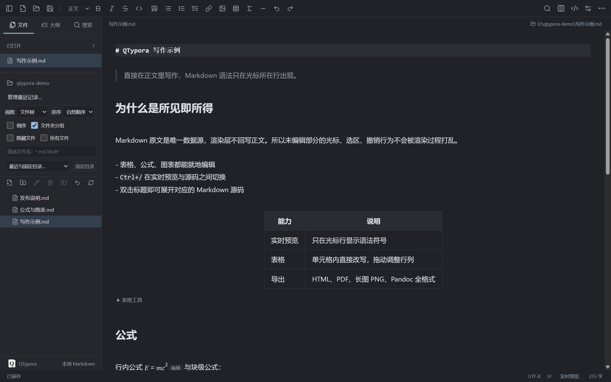
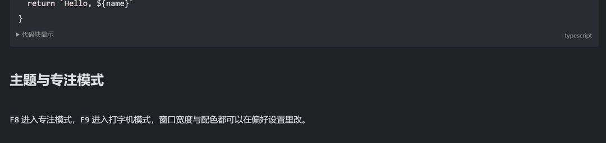
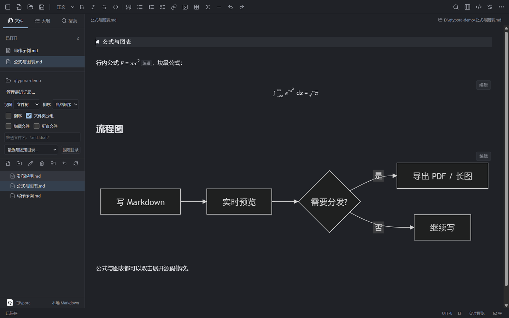

<div align="center">


<h1>QTypora</h1>

<p><strong>A local Markdown editor</strong> with live preview, math and diagrams, and PDF or long-image export.<br>
Runs on Windows and macOS, and keeps every document in a plain <code>.md</code> file.</p>

<p>
<a href="README.md">简体中文</a> ·
<a href="README.zh-TW.md">繁體中文</a> ·
<a href="README.en.md"><b>English</b></a> ·
<a href="README.ja.md">日本語</a> ·
<a href="README.ko.md">한국어</a> ·
<a href="README.es.md">Español</a>
</p>

<p>
<a href="https://github.com/sleepdecidehair/qtypora/releases"></a>
<a href="https://github.com/sleepdecidehair/qtypora/releases"></a>


</p>



</div>

QTypora is a desktop Markdown editor for Windows and macOS that follows Typora's live-preview editing model. Documents stay in ordinary `.md` files; preferences and recovery drafts live in the application user directory.

A Windows 10 / 11 x64 internal build is available now. The same source also produces separate arm64 and x64 internal DMGs on macOS. Features are still changing, and the roadmap lives in a Chinese requirements document; planned items there do not mean shipped or accepted.

Features · [Screenshots](#screenshots) · [Download](#download) · [Shortcuts](#shortcuts) · [Development](#development) · [Project layout](#layout) · [Limits](#limits) · [License](#license)

## Why QTypora

| ✍️ Live preview | 🔒 Local first | 🧰 The parts that matter |
| :--- | :--- | :--- |
| You edit inside the rendered text. Markdown syntax appears only on the line holding the cursor, and double-clicking a heading reveals its source. | Documents are plain `.md` files. Preferences and drafts stay on your machine. No account, no upload. | Math, diagrams, tables, an outline, workspace search, and PDF or long-image export all work today. |

<a id="features"></a>
## ✨ Features

| | Capability |
| :--- | :--- |
| 📝 **Markdown editing** | Live preview and source mode; YAML front matter, in-document TOC, alerts, footnotes, emoji, math and diagrams; extensible syntax, pairing and code-block display settings |
| 🖼 **Images and tables** | Multi-image selection, paste and drag-drop, image directory and sizing, resource tidy-up, configurable uploader; table resizing, row/column moves and multi-cell edits |
| 🗂 **Document management** | File tree and article list, sorting and filters, recent and pinned folders, workspace moves and renames, undo for new/duplicate within a session, multiple windows, quick open; search with whole-word, RE2 regex and directory exclusions |
| 💾 **Local saving** | Save, save as, save all, conflict checks, recovery drafts, optional auto-save, and restoring the last file or folder at startup |
| 🎨 **Writing and appearance** | Outline highlighting, filtering and folding, word statistics with reading time, floating toolbar, platform spellcheck and dictionaries; light and dark palettes, fonts, body CSS, focus and typewriter modes, page zoom |
| 📤 **Import and export** | HTML, plain HTML, PDF, long-image PNG, Markdown, system printing, and reuse of the last export across restarts; other formats through a Pandoc or custom converter you install |

<a id="screenshots"></a>
## 🖼 Screenshots

Typing becomes typeset text as you go. Syntax appears only on the current line:

<div align="center">

</div>

Math and Mermaid diagrams render in place, and double-clicking opens their source:

<div align="center">

</div>

<a id="download"></a>
## ⬇ Download

| Platform | Status | How to get it |
| :--- | :--- | :--- |
| Windows 10 / 11 x64 | Internal build | Download the [QTypora 0.1.0 Windows x64 installer](https://github.com/sleepdecidehair/qtypora/releases/download/v0.1.0-internal/QTypora-0.1.0-internal-x64-setup.exe) and pick an install directory in the wizard |
| macOS arm64 / x64 | Build it yourself | Run `npm run package:mac:internal` on an Apple Silicon Mac to produce two separate DMGs |
| Source | Available | Clone the repository and follow [Development](#development) |

SHA-256 checksums and the public certificate are on the [release page](https://github.com/sleepdecidehair/qtypora/releases/tag/v0.1.0-internal). The internal build is self-signed, so Windows may warn about an unknown publisher or show a SmartScreen prompt. Certificate checks are described in the packaging documentation.

Every branch push builds an installer for that commit; new versions appear under [all releases](https://github.com/sleepdecidehair/qtypora/releases).

<a id="shortcuts"></a>
## ⌨ Shortcuts

| Windows / macOS | Action |
| :--- | :--- |
| `Ctrl/Command+N` / `Ctrl/Command+Shift+N` | New document / new window |
| `Ctrl/Command+O` | Open document |
| `Ctrl/Command+S` / `Ctrl/Command+Shift+S` | Save / save as |
| `Ctrl/Command+W` | Close current document |
| `Ctrl/Command+F` / `Ctrl/Command+H` | Find / replace |
| `Ctrl/Command+/` | Toggle source mode |
| `Ctrl/Command+,` | Preferences |
| `Ctrl/Command+Shift+L` | Show or hide the sidebar |
| `F8` / `F9` / `F11` | Focus mode / typewriter mode / full screen |

These are the defaults. Application menu shortcuts can be changed, disabled or reset in preferences; fixed editor keys and native cut, copy and paste stay reserved, and conflicting bindings are rejected.

Press `Ctrl+/` to switch between live preview and source. In live preview, double-clicking formatted content reveals the underlying Markdown; `Ctrl+E` selects the current style or table cell, and `Ctrl+Click` opens links.

<a id="development"></a>
## 🛠 Development

You need Windows or macOS, Node.js **>=22.12.0** and npm. People installing the packaged app do not need Node.js.

```bash
npm ci
npm run build:icon
npm run dev
```

`npm ci` installs dependencies from [package-lock.json](package-lock.json). `dev` starts the Electron window and the local dev server. Generating the icon explicitly keeps builds working where npm lifecycle scripts are disabled.

If install scripts were disabled and the Electron runtime is missing, fetch it manually:

```bash
node node_modules/electron/install.js
```

To download through an existing system proxy, set `$env:ELECTRON_GET_USE_PROXY = '1'` in the terminal first.

<a id="layout"></a>
## 🧭 Project layout

The stack comes from [package.json](package.json): Electron 44, React 19, TypeScript 7, electron-vite 5, Vite 7, CodeMirror 6, Markdown-it, MathJax, Mermaid and DOMPurify.

| Path | Responsibility |
| :--- | :--- |
| `src/main/` | Windows, menus, file service, document state, conflict checks, preferences, drafts, resources and export |
| `src/preload/` | The fixed desktop API exposed to the renderer |
| [src/shared/contracts.ts](src/shared/contracts.ts) | Types, results and event contracts shared by main and renderer |
| `src/renderer/` | React UI, CodeMirror editor, file tree, outline, search and themes |
| `tests/` | End-to-end Electron tests; unit tests sit next to their sources |
| `scripts/`, `build/` | Packaging, signing, checks, brand and installer assets |
| `docs/` | Requirements, research, verification records and postmortems |

Markdown source is the only document model; the renderer never rebuilds a document from rendered HTML. The renderer reaches local services through the preload bridge and never touches Node.js directly, and windows keep context isolation and the sandbox enabled.

<a id="limits"></a>
## 🚧 Limits

UTF-8 and UTF-8 BOM are supported. Saving an unmodified document keeps its original bytes; after an edit the detected LF or CRLF and encoding are preserved. Source editing is capped at 16 MB per document and live preview at 200,000 characters; above that, source editing stays available. Save-all stops on cancel or failure, and save-as across directories warns about relative image references that will break.

Tables, image paste and drag-drop, rich-text conversion, themes and export presets are in place, but Typora parity is not fully verified. Full UI localization, automatic updates, a theme or plugin marketplace and a first-party sync service are not implemented. Session history holds at most 20 file and directory operations and does not restore deletions from the system recycle bin.

Workspace indexing covers at most 200 directories, 5,000 files and 20,000 entries; directory search returns at most 1,000 results, and long-image export tops out at 16,000 pixels. Existing Typora theme folders, main CSS and `user.css` overlays support only part of the body styles, variables and media queries, so third-party Typora themes are not fully compatible. The macOS internal DMGs are ad-hoc signed and notarization has not been submitted.

<a id="license"></a>
## ⚖ License

The project license is not decided yet, so no license is granted for use, copying or redistribution. Licenses of bundled open-source components do not grant a license for QTypora itself.

Third-party notices ship with the app under Help → Third-party licenses. The project documentation (requirements, packaging, verification records and postmortems) is currently written in Chinese; the [Chinese README](README.md) links to it.

<div align="center">

If QTypora is useful to you, a star is welcome. Missing something? Open an [issue](https://github.com/sleepdecidehair/qtypora/issues).

<a href="README.md">简体中文</a> · <a href="README.zh-TW.md">繁體中文</a> · <a href="README.en.md">English</a> · <a href="README.ja.md">日本語</a> · <a href="README.ko.md">한국어</a> · <a href="README.es.md">Español</a>

</div>
