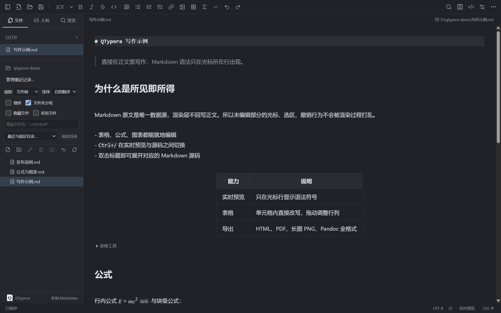
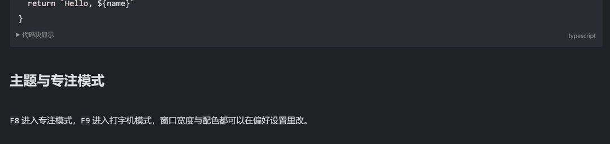
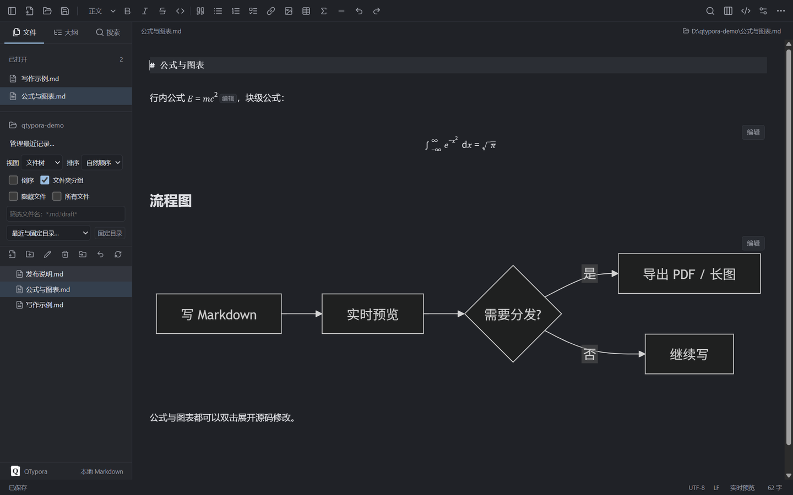

<div align="center">


<h1>QTypora</h1>

<p><strong>Un editor de Markdown local</strong> con vista previa en vivo, fórmulas y diagramas, y exportación a PDF o a imagen larga.<br>
Funciona en Windows y macOS, y guarda cada documento en un archivo <code>.md</code> normal.</p>

<p>
<a href="README.md">简体中文</a> ·
<a href="README.zh-TW.md">繁體中文</a> ·
<a href="README.en.md">English</a> ·
<a href="README.ja.md">日本語</a> ·
<a href="README.ko.md">한국어</a> ·
<a href="README.es.md"><b>Español</b></a>
</p>

<p>
<a href="https://github.com/sleepdecidehair/qtypora/releases"></a>
<a href="https://github.com/sleepdecidehair/qtypora/releases"></a>


</p>



</div>

QTypora es un editor de Markdown de escritorio para Windows y macOS que sigue el modelo de vista previa en vivo de Typora. Los documentos viven en archivos `.md` normales; las preferencias y los borradores de recuperación se guardan en el directorio de usuario de la aplicación.

Ya hay un instalador interno para Windows 10 / 11 x64. El mismo código también genera dos DMG internos, arm64 y x64, en macOS. Las funciones siguen cambiando y el documento de requisitos está en chino: los elementos planificados allí no implican que estén implementados o aceptados.

Funciones · [Capturas](#screenshots) · [Descarga](#download) · [Atajos](#shortcuts) · [Desarrollo](#development) · [Estructura](#layout) · [Límites](#limits) · [Licencia](#license)

## Por qué usarlo

| ✍️ Vista previa en vivo | 🔒 Primero lo local | 🧰 Lo que hace falta |
| :--- | :--- | :--- |
| Editas dentro del texto ya formateado. La sintaxis Markdown aparece solo en la línea del cursor y al hacer doble clic en un título se ve su código. | Los documentos son archivos `.md` normales. Las preferencias y los borradores se quedan en tu equipo. Sin cuenta y sin subir nada. | Fórmulas, diagramas, tablas, esquema, búsqueda en el espacio de trabajo y exportación a PDF o imagen larga ya funcionan. |

<a id="features"></a>
## ✨ Funciones

| | Capacidad |
| :--- | :--- |
| 📝 **Edición de Markdown** | Vista previa en vivo y modo código; YAML, índice del documento, alertas, notas al pie, emoji, fórmulas y diagramas; sintaxis ampliada, emparejamiento y visualización de bloques de código configurables |
| 🖼 **Imágenes y tablas** | Selección de varias imágenes, pegar y arrastrar, carpeta y tamaño de imágenes, orden de recursos y cargador configurable; cambio de tamaño de tabla, movimiento de filas y columnas y edición de varias celdas |
| 🗂 **Gestión de documentos** | Árbol de archivos y lista de artículos, orden y filtros, carpetas recientes y fijadas, mover y renombrar dentro del espacio de trabajo, deshacer en la sesión al crear o duplicar, varias ventanas y apertura rápida; búsqueda por palabra completa, expresión regular RE2 y exclusión de carpetas |
| 💾 **Guardado local** | Guardar, guardar como, guardar todo, comprobación de conflictos, borradores de recuperación y autoguardado opcional; al arrancar se restaura el último archivo o carpeta |
| 🎨 **Escritura y aspecto** | Resaltado, filtro y plegado del esquema, recuento de palabras y tiempo de lectura, barra flotante, corrección ortográfica y diccionarios del sistema; paletas clara y oscura, fuentes, CSS del cuerpo, modo concentración y máquina de escribir, zoom |
| 📤 **Importar y exportar** | HTML, HTML sin estilos, PDF, PNG de imagen larga, Markdown, impresión del sistema y reutilización de la última exportación entre reinicios; otros formatos mediante un Pandoc o un conversor propio que instales tú |

<a id="screenshots"></a>
## 🖼 Capturas

Escribes y el texto se compone al momento; la sintaxis solo aparece en la línea activa:

<div align="center">

</div>

Las fórmulas y los diagramas Mermaid se dibujan en su sitio, y con doble clic se abre su código:

<div align="center">

</div>

<a id="download"></a>
## ⬇ Descarga

| Plataforma | Estado | Cómo obtenerlo |
| :--- | :--- | :--- |
| Windows 10 / 11 x64 | Compilación interna | Descarga el [instalador QTypora 0.1.0 para Windows x64](https://github.com/sleepdecidehair/qtypora/releases/download/v0.1.0-internal/QTypora-0.1.0-internal-x64-setup.exe) y elige la carpeta en el asistente |
| macOS arm64 / x64 | Compílalo tú | Ejecuta `npm run package:mac:internal` en un Mac con Apple Silicon para generar dos DMG separados |
| Código fuente | Disponible | Clona el repositorio y sigue [Desarrollo](#development) |

Los archivos SHA-256 y el certificado público están en la [página de la versión](https://github.com/sleepdecidehair/qtypora/releases/tag/v0.1.0-internal). La compilación interna está autofirmada, así que Windows puede avisar de un editor desconocido o mostrar SmartScreen.

Cada push a una rama genera el instalador de ese commit; las versiones nuevas aparecen en [todas las versiones](https://github.com/sleepdecidehair/qtypora/releases).

<a id="shortcuts"></a>
## ⌨ Atajos

| Windows / macOS | Acción |
| :--- | :--- |
| `Ctrl/Command+N` / `Ctrl/Command+Shift+N` | Documento nuevo / ventana nueva |
| `Ctrl/Command+O` | Abrir documento |
| `Ctrl/Command+S` / `Ctrl/Command+Shift+S` | Guardar / guardar como |
| `Ctrl/Command+W` | Cerrar el documento actual |
| `Ctrl/Command+F` / `Ctrl/Command+H` | Buscar / reemplazar |
| `Ctrl/Command+/` | Cambiar al modo código |
| `Ctrl/Command+,` | Preferencias |
| `Ctrl/Command+Shift+L` | Mostrar u ocultar la barra lateral |
| `F8` / `F9` / `F11` | Modo concentración / máquina de escribir / pantalla completa |

Son los valores por defecto. Los atajos del menú se pueden cambiar, desactivar o restaurar en las preferencias; las teclas fijas del editor y las nativas de cortar, copiar y pegar quedan reservadas, y las combinaciones en conflicto se rechazan.

`Ctrl+/` alterna entre vista previa y código. En la vista previa, el doble clic sobre contenido formateado abre su Markdown; `Ctrl+E` selecciona el estilo actual o la celda de la tabla y `Ctrl+Click` abre enlaces.

<a id="development"></a>
## 🛠 Desarrollo

Necesitas Windows o macOS, Node.js **>=22.12.0** y npm. Quien instala la aplicación no necesita Node.js.

```bash
npm ci
npm run build:icon
npm run dev
```

`npm ci` instala las dependencias según [package-lock.json](package-lock.json). `dev` abre la ventana de Electron y el servidor de desarrollo local. Generar el icono de forma explícita mantiene la compilación en entornos donde los scripts de npm están desactivados.

Si los scripts de instalación están desactivados y falta el tiempo de ejecución de Electron, descárgalo a mano:

```bash
node node_modules/electron/install.js
```

Para descargar a través de un proxy del sistema, define `$env:ELECTRON_GET_USE_PROXY = '1'` en la terminal.

<a id="layout"></a>
## 🧭 Estructura

El conjunto técnico sale de [package.json](package.json): Electron 44, React 19, TypeScript 7, electron-vite 5, Vite 7, CodeMirror 6, Markdown-it, MathJax, Mermaid y DOMPurify.

| Ruta | Responsabilidad |
| :--- | :--- |
| `src/main/` | Ventanas, menús, servicio de archivos, estado del documento, conflictos, preferencias, borradores, recursos y exportación |
| `src/preload/` | La API de escritorio fija que se expone a la interfaz |
| [src/shared/contracts.ts](src/shared/contracts.ts) | Tipos, resultados y contratos de eventos compartidos |
| `src/renderer/` | Interfaz React, editor CodeMirror, árbol de archivos, esquema, búsqueda y temas |
| `tests/` | Pruebas de integración con Electron real; las pruebas unitarias viven junto al código |
| `scripts/`, `build/` | Empaquetado, firma, comprobaciones y recursos de marca e instalador |
| `docs/` | Requisitos, investigación, registros de verificación y análisis de fallos |

El Markdown original es el único modelo del documento; la interfaz nunca reconstruye un documento desde el HTML renderizado. La interfaz llama a los servicios locales a través del puente de precarga y no toca Node.js directamente, y las ventanas mantienen el aislamiento de contexto y el sandbox.

<a id="limits"></a>
## 🚧 Límites actuales

Se admiten UTF-8 y UTF-8 BOM. Guardar sin cambios conserva los bytes originales; tras editar se mantienen el LF o CRLF detectado y la codificación. La edición de código está limitada a 16 MB por documento y la vista previa a 200.000 caracteres; por encima solo queda el modo código. Guardar todo se detiene si se cancela o falla.

Las tablas, el pegado y arrastre de imágenes, la conversión de texto enriquecido, los temas y los ajustes de exportación están disponibles, pero la equivalencia completa con Typora no está verificada. Faltan la traducción completa de la interfaz, las actualizaciones automáticas, un mercado de temas y complementos y una sincronización propia. El historial de operaciones guarda como máximo 20 entradas y no recupera borrados de la papelera del sistema.

El índice del espacio de trabajo cubre hasta 200 carpetas, 5.000 archivos y 20.000 entradas; la búsqueda devuelve como máximo 1.000 resultados y la imagen larga llega a 16.000 píxeles de alto. Las carpetas de temas de Typora, el CSS principal y las capas `user.css` solo cubren parte de los estilos, variables y consultas de medios, así que los temas de terceros no son del todo compatibles. Los DMG internos de macOS están firmados en modo ad-hoc y no se han notarizado.

<a id="license"></a>
## ⚖ Licencia

La licencia del proyecto aún no está decidida, así que no se concede permiso de uso, copia ni redistribución. Las licencias de los componentes de código abierto incluidos no otorgan licencia sobre QTypora.

Los avisos de terceros se distribuyen con la aplicación y se ven en Ayuda → Licencias de terceros. La documentación técnica (requisitos, empaquetado, verificaciones y análisis) está escrita en chino; el [README en chino](README.md) reúne los enlaces.

<div align="center">

Si QTypora te resulta útil, una estrella es bienvenida. Si falta algo, abre un [issue](https://github.com/sleepdecidehair/qtypora/issues).

<a href="README.md">简体中文</a> · <a href="README.zh-TW.md">繁體中文</a> · <a href="README.en.md">English</a> · <a href="README.ja.md">日本語</a> · <a href="README.ko.md">한국어</a> · <a href="README.es.md">Español</a>

</div>
