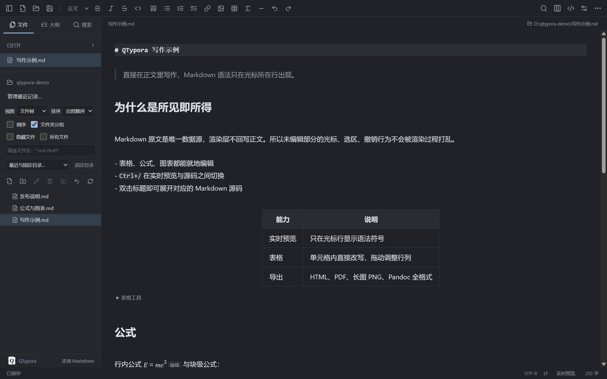
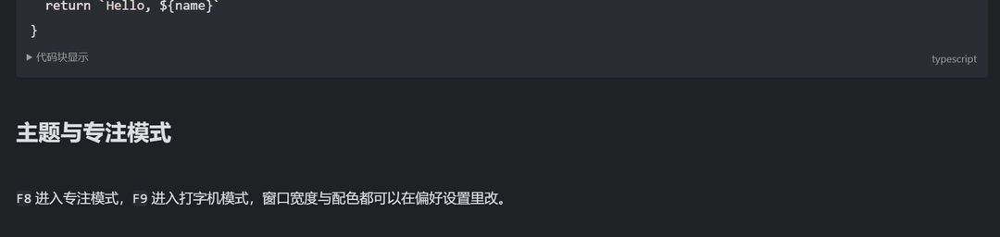
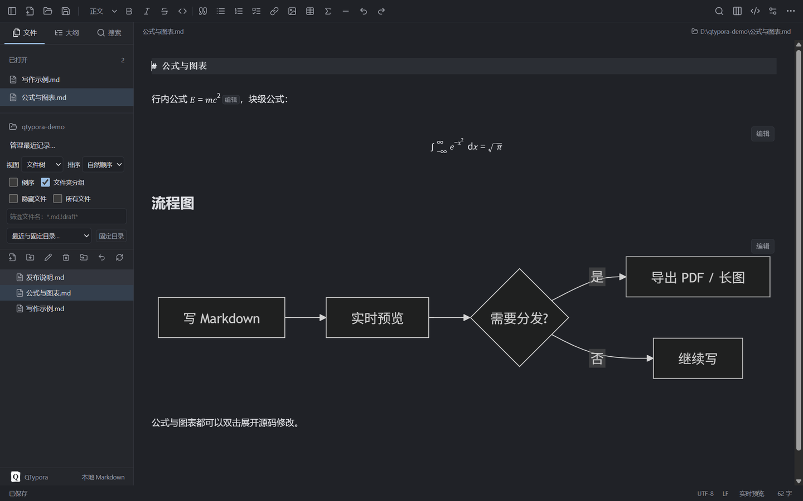

<div align="center">


<h1>QTypora</h1>

<p><strong>ローカルで動く Markdown エディタ</strong>。ライブプレビュー、数式と図表、PDF と長い画像の書き出しに対応。<br>
Windows と macOS で動作し、文書は普通の <code>.md</code> ファイルとして保存されます。</p>

<p>
<a href="README.md">简体中文</a> ·
<a href="README.zh-TW.md">繁體中文</a> ·
<a href="README.en.md">English</a> ·
<a href="README.ja.md"><b>日本語</b></a> ·
<a href="README.ko.md">한국어</a> ·
<a href="README.es.md">Español</a>
</p>

<p>
<a href="https://github.com/sleepdecidehair/qtypora/releases"></a>
<a href="https://github.com/sleepdecidehair/qtypora/releases"></a>


</p>



</div>

QTypora は Windows と macOS 向けのデスクトップ Markdown エディタで、ライブプレビューの操作感は Typora を参考にしています。文書は普通の `.md` ファイルに保存され、設定と復元用の下書きはアプリのユーザーディレクトリに置かれます。

現在は Windows 10 / 11 x64 の内部テスト版インストーラーを公開しています。同じソースから macOS 用の arm64 と x64 の DMG も個別に作成できます。機能はまだ更新中で、要件定義書は中国語で書かれており、そこに書かれた計画項目は実装済み・検収済みを意味しません。

機能 · [画面](#screenshots) · [ダウンロード](#download) · [ショートカット](#shortcuts) · [開発](#development) · [構成](#layout) · [制限](#limits) · [ライセンス](#license)

## 選ばれる理由

| ✍️ ライブプレビュー | 🔒 ローカル優先 | 🧰 必要な機能が揃う |
| :--- | :--- | :--- |
| 整形された本文をそのまま編集でき、Markdown の記法はカーソル行にだけ表示されます。見出しをダブルクリックすると元の記法が開きます。 | 文書は普通の `.md` ファイル。設定も下書きも手元に残り、アカウントもアップロードも不要です。 | 数式、図表、表、アウトライン、ワークスペース検索、PDF と長い画像の書き出しが使えます。 |

<a id="features"></a>
## ✨ 機能

| | 内容 |
| :--- | :--- |
| 📝 **Markdown 編集** | ライブプレビューとソース表示の切り替え。YAML、文書内目次、Alerts、脚注、絵文字、数式と図表。拡張記法、記号の補完、コードブロックの表示を設定可能 |
| 🖼 **画像と表** | 複数画像の選択、貼り付けとドラッグ＆ドロップ、画像ディレクトリとサイズ、リソース整理、設定可能なアップローダー。表のサイズ変更、行列入れ替え、複数セル編集 |
| 🗂 **文書管理** | ファイルツリーと記事一覧、並び替えと絞り込み、最近使ったフォルダーと固定フォルダー、ワークスペース内の移動と名前変更、新規作成・複製のセッション内 undo、複数ウィンドウ、クイックオープン。検索は単語単位、RE2 正規表現、ディレクトリ除外に対応 |
| 💾 **ローカル保存** | 保存、名前を付けて保存、すべて保存、競合チェック、復元用の下書き、任意の自動保存。起動時に前回のファイルやフォルダーを復元 |
| 🎨 **執筆と外観** | アウトラインの強調・絞り込み・折りたたみ、文字数と読了時間、フローティングツールバー、OS のスペルチェックと辞書。明暗の配色、フォント、本文 CSS、集中モードとタイプライターモード、ページズーム |
| 📤 **読み込みと書き出し** | HTML、スタイルなし HTML、PDF、長い画像 PNG、Markdown、OS の印刷。再起動後も前回の書き出し設定を再利用。その他の形式は自分で用意した Pandoc や独自の変換プログラムで出力 |

<a id="screenshots"></a>
## 🖼 画面

入力しながら整形され、記法はカーソル行にだけ現れます。

<div align="center">

</div>

数式と Mermaid の図はその場で描画され、ダブルクリックで元の記法を開けます。

<div align="center">

</div>

<a id="download"></a>
## ⬇ ダウンロード

| プラットフォーム | 状態 | 入手方法 |
| :--- | :--- | :--- |
| Windows 10 / 11 x64 | 内部テスト版 | [QTypora 0.1.0 Windows x64 インストーラー](https://github.com/sleepdecidehair/qtypora/releases/download/v0.1.0-internal/QTypora-0.1.0-internal-x64-setup.exe) をダウンロードし、ウィザードでインストール先を選びます |
| macOS arm64 / x64 | 自分でビルド | Apple Silicon の Mac で `npm run package:mac:internal` を実行すると 2 つの DMG ができます |
| ソースコード | 利用可能 | リポジトリを取得し、[開発](#development) の手順で起動します |

SHA-256 のチェックサムと公開証明書は [リリースページ](https://github.com/sleepdecidehair/qtypora/releases/tag/v0.1.0-internal) にあります。内部テスト版は自己署名のため、Windows で発行元不明の警告や SmartScreen の案内が出ることがあります。

ブランチへ push するたびにそのコミットのインストーラーが作られ、新しい版は [リリース一覧](https://github.com/sleepdecidehair/qtypora/releases) に並びます。

<a id="shortcuts"></a>
## ⌨ ショートカット

| Windows / macOS | 動作 |
| :--- | :--- |
| `Ctrl/Command+N` / `Ctrl/Command+Shift+N` | 新規文書 / 新規ウィンドウ |
| `Ctrl/Command+O` | 文書を開く |
| `Ctrl/Command+S` / `Ctrl/Command+Shift+S` | 保存 / 名前を付けて保存 |
| `Ctrl/Command+W` | 現在の文書を閉じる |
| `Ctrl/Command+F` / `Ctrl/Command+H` | 検索 / 置換 |
| `Ctrl/Command+/` | ソース表示の切り替え |
| `Ctrl/Command+,` | 設定 |
| `Ctrl/Command+Shift+L` | サイドバーの表示切り替え |
| `F8` / `F9` / `F11` | 集中モード / タイプライターモード / 全画面 |

表示しているのは既定値です。アプリメニューのショートカットは設定で変更・無効化・初期化できます。エディタ固定のキーと OS 標準の切り取り・コピー・貼り付けは予約され、重複する設定は拒否されます。

`Ctrl+/` でライブプレビューとソース表示を切り替えます。ライブプレビューでは、整形された内容をダブルクリックすると元の記法が開きます。`Ctrl+E` で現在の書式や表のセルを選択し、`Ctrl+Click` でリンクを開きます。

<a id="development"></a>
## 🛠 開発

Windows または macOS、Node.js **>=22.12.0**、npm が必要です。インストーラーを使う人に Node.js は不要です。

```bash
npm ci
npm run build:icon
npm run dev
```

`npm ci` は [package-lock.json](package-lock.json) に従って依存関係を入れます。`dev` は Electron のウィンドウとローカル開発サーバーを起動します。npm のライフサイクルスクリプトが無効な環境では、アイコンを明示的に生成してください。

インストールスクリプトが無効で Electron のランタイムが無い場合は、手動で取得します。

```bash
node node_modules/electron/install.js
```

既存のシステムプロキシ経由で取得する場合は、先にターミナルで `$env:ELECTRON_GET_USE_PROXY = '1'` を設定します。

<a id="layout"></a>
## 🧭 構成

技術構成は [package.json](package.json) のとおりです。Electron 44、React 19、TypeScript 7、electron-vite 5、Vite 7、CodeMirror 6、Markdown-it、MathJax、Mermaid、DOMPurify を使っています。

| パス | 役割 |
| :--- | :--- |
| `src/main/` | ウィンドウ、メニュー、ファイルサービス、文書状態、競合チェック、設定、下書き、リソース、書き出し |
| `src/preload/` | 画面に公開する固定のデスクトップ API |
| [src/shared/contracts.ts](src/shared/contracts.ts) | メインと画面で共有する型・結果・イベントの契約 |
| `src/renderer/` | React の画面、CodeMirror エディタ、ファイルツリー、アウトライン、検索、テーマ |
| `tests/` | 実際の Electron を使う結合テスト。単体テストはソースの隣にあります |
| `scripts/`、`build/` | パッケージ、署名、検査スクリプト、ブランドとインストーラーの素材 |
| `docs/` | 要件、調査、検証記録、障害の振り返り |

Markdown の原文が唯一の文書モデルで、画面が描画後の HTML から文書を作り直すことはありません。画面はプリロード経由でローカル機能を呼び、Node.js へ直接は触れません。ウィンドウはコンテキスト分離とサンドボックスを有効にしています。

<a id="limits"></a>
## 🚧 現在の制限

UTF-8 と UTF-8 BOM に対応しています。変更せずに保存した場合は元のバイト列を保ち、編集後は検出した LF / CRLF とエンコーディングを引き継ぎます。ソース編集の上限は 1 文書 16 MB、ライブプレビューの上限は 200,000 文字で、超えた場合はソース編集のみ使えます。すべて保存は取り消しや失敗で停止します。

表、画像の貼り付けとドラッグ＆ドロップ、リッチテキスト変換、テーマ、書き出し設定は用意していますが、Typora との完全な同等性はまだ検証していません。画面の完全な多言語化、自動更新、テーマやプラグインのマーケット、独自のクラウド同期は未実装です。ファイルとフォルダーの操作履歴は最大 20 件で、ゴミ箱からの復元は含みません。

ワークスペース索引は 200 ディレクトリ、5,000 ファイル、20,000 項目まで、ディレクトリ検索は 1,000 件まで、長い画像は高さ 16,000 ピクセルまでです。既存の Typora テーマフォルダー、メイン CSS、`user.css` の上書きは本文スタイル、変数、メディアクエリの一部にしか対応しておらず、第三者の Typora テーマとは完全互換ではありません。macOS の内部テスト版 DMG は ad-hoc 署名で、公証は受けていません。

<a id="license"></a>
## ⚖ ライセンス

プロジェクトのライセンスは未定のため、使用・複製・再配布は許諾されていません。同梱するオープンソースコンポーネントのライセンスが QTypora 自体の許諾になることはありません。

第三者のライセンス表示はアプリに同梱され、「ヘルプ → サードパーティライセンス」から確認できます。要件、パッケージ、検証記録などの技術文書は現在中国語で、リンクは [中国語 README](README.md) にまとめています。

<div align="center">

QTypora が役に立ったら Star をいただけると嬉しいです。足りない機能は [issue](https://github.com/sleepdecidehair/qtypora/issues) で教えてください。

<a href="README.md">简体中文</a> · <a href="README.zh-TW.md">繁體中文</a> · <a href="README.en.md">English</a> · <a href="README.ja.md">日本語</a> · <a href="README.ko.md">한국어</a> · <a href="README.es.md">Español</a>

</div>
