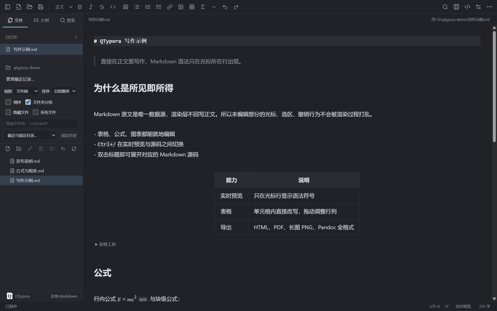
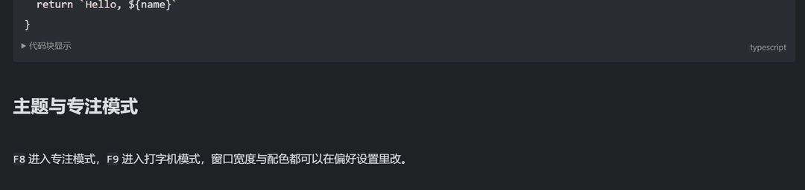
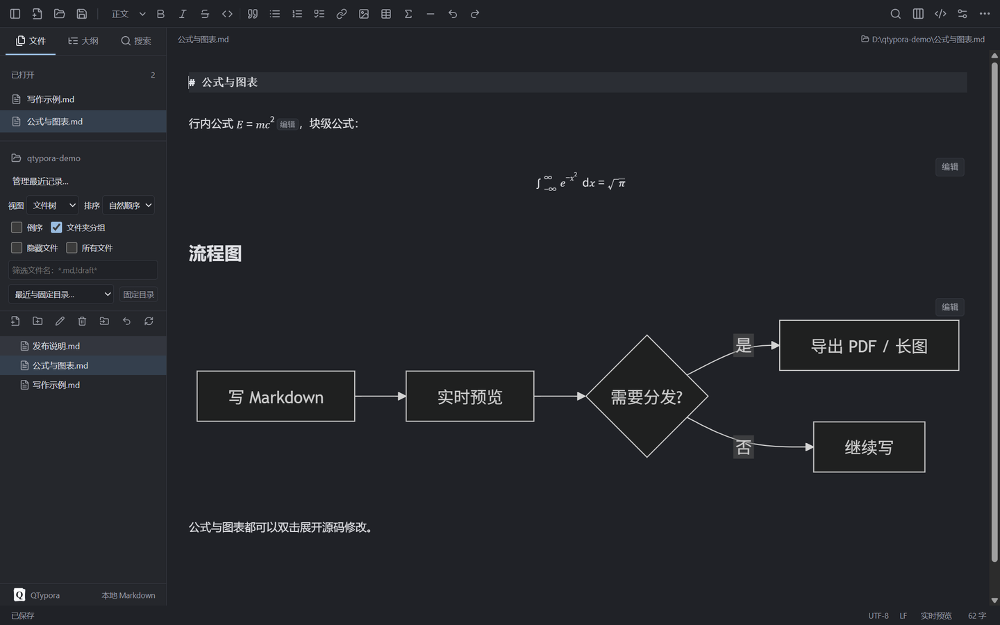

<div align="center">


<h1>QTypora</h1>

<p><strong>로컬에서 동작하는 Markdown 편집기</strong>. 실시간 미리보기, 수식과 다이어그램, PDF와 긴 이미지 내보내기.<br>
Windows와 macOS에서 실행되고, 문서는 평범한 <code>.md</code> 파일로 저장됩니다.</p>

<p>
<a href="README.md">简体中文</a> ·
<a href="README.zh-TW.md">繁體中文</a> ·
<a href="README.en.md">English</a> ·
<a href="README.ja.md">日本語</a> ·
<a href="README.ko.md"><b>한국어</b></a> ·
<a href="README.es.md">Español</a>
</p>

<p>
<a href="https://github.com/sleepdecidehair/qtypora/releases"></a>
<a href="https://github.com/sleepdecidehair/qtypora/releases"></a>


</p>



</div>

QTypora는 Windows와 macOS용 데스크톱 Markdown 편집기이며, 실시간 미리보기 방식은 Typora를 참고했습니다. 문서는 평범한 `.md` 파일로 남고, 설정과 복구용 초안은 앱의 사용자 디렉터리에 저장됩니다.

현재 Windows 10 / 11 x64 내부 테스트용 설치 파일을 제공합니다. 같은 소스로 macOS용 arm64, x64 DMG를 각각 만들 수 있습니다. 기능은 계속 바뀌고 있으며 요구사항 문서는 중국어로 작성되어 있습니다. 문서에 적힌 계획 항목은 구현이나 검수를 뜻하지 않습니다.

기능 · [화면](#screenshots) · [다운로드](#download) · [단축키](#shortcuts) · [개발](#development) · [구조](#layout) · [제한](#limits) · [라이선스](#license)

## 선택한 이유

| ✍️ 실시간 미리보기 | 🔒 로컬 우선 | 🧰 필요한 기능 |
| :--- | :--- | :--- |
| 서식이 적용된 본문을 그대로 편집하고, Markdown 문법은 커서가 있는 줄에만 나타납니다. 제목을 두 번 클릭하면 원본 문법이 열립니다. | 문서는 평범한 `.md` 파일입니다. 설정과 초안은 내 컴퓨터에 남고, 계정도 업로드도 필요 없습니다. | 수식, 다이어그램, 표, 아웃라인, 작업 공간 검색, PDF와 긴 이미지 내보내기가 모두 동작합니다. |

<a id="features"></a>
## ✨ 기능

| | 내용 |
| :--- | :--- |
| 📝 **Markdown 편집** | 실시간 미리보기와 소스 모드 전환. YAML, 문서 내 목차, Alerts, 각주, 이모지, 수식과 다이어그램. 확장 문법, 기호 자동 완성, 코드 블록 표시 설정 |
| 🖼 **이미지와 표** | 여러 이미지 선택, 붙여넣기와 드래그 앤 드롭, 이미지 디렉터리와 크기, 리소스 정리, 설정 가능한 업로더. 표 크기 조정, 행과 열 이동, 여러 셀 편집 |
| 🗂 **문서 관리** | 파일 트리와 글 목록, 정렬과 필터, 최근 폴더와 고정 폴더, 작업 공간 안에서 이동과 이름 변경, 새 문서와 복제의 세션 내 실행 취소, 여러 창, 빠른 열기. 검색은 단어 단위, RE2 정규식, 디렉터리 제외를 지원 |
| 💾 **로컬 저장** | 저장, 다른 이름으로 저장, 모두 저장, 충돌 확인, 복구용 초안, 선택적 자동 저장. 시작할 때 마지막 파일이나 폴더 복원 |
| 🎨 **집필과 화면** | 아웃라인 강조, 필터, 접기, 글자 수와 읽기 시간, 떠 있는 도구 모음, 운영체제 맞춤법 검사와 사전. 밝은/어두운 배색, 글꼴, 본문 CSS, 집중 모드와 타자기 모드, 페이지 확대 |
| 📤 **가져오기와 내보내기** | HTML, 스타일 없는 HTML, PDF, 긴 이미지 PNG, Markdown, 시스템 인쇄, 다시 시작해도 마지막 내보내기 설정 재사용. 그 밖의 형식은 직접 설치한 Pandoc이나 사용자 정의 변환 프로그램으로 출력 |

<a id="screenshots"></a>
## 🖼 화면

입력하는 동안 서식이 만들어지고, 문법 기호는 커서 줄에만 보입니다.

<div align="center">

</div>

수식과 Mermaid 다이어그램은 그 자리에서 그려지고, 두 번 클릭하면 원본 문법이 열립니다.

<div align="center">

</div>

<a id="download"></a>
## ⬇ 다운로드

| 플랫폼 | 상태 | 받는 방법 |
| :--- | :--- | :--- |
| Windows 10 / 11 x64 | 내부 테스트 빌드 | [QTypora 0.1.0 Windows x64 설치 파일](https://github.com/sleepdecidehair/qtypora/releases/download/v0.1.0-internal/QTypora-0.1.0-internal-x64-setup.exe)을 내려받고 설치 마법사에서 폴더를 고릅니다 |
| macOS arm64 / x64 | 직접 빌드 | Apple Silicon Mac에서 `npm run package:mac:internal`을 실행하면 DMG 두 개가 만들어집니다 |
| 소스 | 사용 가능 | 저장소를 받은 뒤 [개발](#development) 절차로 실행합니다 |

SHA-256 검증 파일과 공개 인증서는 [릴리스 페이지](https://github.com/sleepdecidehair/qtypora/releases/tag/v0.1.0-internal)에 있습니다. 내부 테스트 빌드는 자체 서명이라 Windows에서 알 수 없는 게시자나 SmartScreen 경고가 나올 수 있습니다.

브랜치를 push할 때마다 그 커밋의 설치 파일이 만들어지고, 새 버전은 [전체 릴리스](https://github.com/sleepdecidehair/qtypora/releases)에 올라갑니다.

<a id="shortcuts"></a>
## ⌨ 단축키

| Windows / macOS | 동작 |
| :--- | :--- |
| `Ctrl/Command+N` / `Ctrl/Command+Shift+N` | 새 문서 / 새 창 |
| `Ctrl/Command+O` | 문서 열기 |
| `Ctrl/Command+S` / `Ctrl/Command+Shift+S` | 저장 / 다른 이름으로 저장 |
| `Ctrl/Command+W` | 현재 문서 닫기 |
| `Ctrl/Command+F` / `Ctrl/Command+H` | 찾기 / 바꾸기 |
| `Ctrl/Command+/` | 소스 모드 전환 |
| `Ctrl/Command+,` | 환경 설정 |
| `Ctrl/Command+Shift+L` | 사이드바 표시 전환 |
| `F8` / `F9` / `F11` | 집중 모드 / 타자기 모드 / 전체 화면 |

위 값은 기본값입니다. 앱 메뉴 단축키는 환경 설정에서 바꾸거나 끄거나 되돌릴 수 있습니다. 편집기 고정 키와 운영체제의 잘라내기, 복사, 붙여넣기는 예약되어 있고, 충돌하는 설정은 거부됩니다.

`Ctrl+/`로 실시간 미리보기와 소스 모드를 오갑니다. 실시간 미리보기에서 서식이 적용된 내용을 두 번 클릭하면 원본 문법이 열리고, `Ctrl+E`는 현재 서식이나 표 셀을 선택하며 `Ctrl+Click`은 링크를 엽니다.

<a id="development"></a>
## 🛠 개발

Windows 또는 macOS, Node.js **>=22.12.0**, npm이 필요합니다. 설치 파일을 쓰는 사람에게는 Node.js가 필요 없습니다.

```bash
npm ci
npm run build:icon
npm run dev
```

`npm ci`는 [package-lock.json](package-lock.json)에 따라 의존성을 설치합니다. `dev`는 Electron 창과 로컬 개발 서버를 띄웁니다. npm 라이프사이클 스크립트를 끈 환경에서는 아이콘을 직접 생성하세요.

설치 스크립트가 꺼져 Electron 런타임이 없다면 직접 받습니다.

```bash
node node_modules/electron/install.js
```

기존 시스템 프록시로 받아야 한다면 터미널에서 먼저 `$env:ELECTRON_GET_USE_PROXY = '1'`을 설정합니다.

<a id="layout"></a>
## 🧭 구조

기술 구성은 [package.json](package.json)을 따릅니다. Electron 44, React 19, TypeScript 7, electron-vite 5, Vite 7, CodeMirror 6, Markdown-it, MathJax, Mermaid, DOMPurify를 씁니다.

| 경로 | 역할 |
| :--- | :--- |
| `src/main/` | 창, 메뉴, 파일 서비스, 문서 상태, 충돌 확인, 설정, 초안, 리소스, 내보내기 |
| `src/preload/` | 화면에 노출하는 고정 데스크톱 API |
| [src/shared/contracts.ts](src/shared/contracts.ts) | 메인과 화면이 공유하는 타입, 결과, 이벤트 계약 |
| `src/renderer/` | React 화면, CodeMirror 편집기, 파일 트리, 아웃라인, 검색, 테마 |
| `tests/` | 실제 Electron 통합 테스트. 단위 테스트는 소스 옆에 있습니다 |
| `scripts/`, `build/` | 패키징, 서명, 검사 스크립트, 브랜드와 설치 리소스 |
| `docs/` | 요구사항, 조사, 검증 기록, 장애 회고 |

Markdown 원문이 유일한 문서 모델이며, 화면이 렌더링된 HTML로 문서를 다시 만들지 않습니다. 화면은 프리로드 브리지로 로컬 기능을 호출하고 Node.js에 직접 접근하지 않으며, 창은 컨텍스트 격리와 샌드박스를 켠 상태로 동작합니다.

<a id="limits"></a>
## 🚧 현재 제한

UTF-8과 UTF-8 BOM을 지원합니다. 수정하지 않고 저장하면 원래 바이트를 유지하고, 편집 후에는 감지한 LF / CRLF와 인코딩을 따릅니다. 소스 편집은 문서당 16 MB, 실시간 미리보기는 200,000자까지이며 그 이상은 소스 편집만 가능합니다. 모두 저장은 취소나 실패에서 멈춥니다.

표, 이미지 붙여넣기와 드래그 앤 드롭, 서식 있는 텍스트 변환, 테마와 내보내기 설정은 준비되어 있지만 Typora와의 전체 동등성 검수는 끝나지 않았습니다. 화면 전체 다국어, 자동 업데이트, 테마와 플러그인 마켓, 자체 클라우드 동기화는 아직 없습니다. 파일과 폴더 작업 기록은 최대 20건이고 휴지통 삭제 복원은 포함하지 않습니다.

작업 공간 색인은 디렉터리 200개, 파일 5,000개, 항목 20,000개까지이며, 디렉터리 검색은 1,000건까지, 긴 이미지는 높이 16,000픽셀까지입니다. 기존 Typora 테마 폴더, 메인 CSS, `user.css` 덮어쓰기는 본문 스타일과 변수, 미디어 쿼리의 일부만 지원하므로 서드파티 Typora 테마와 완전히 호환되지는 않습니다. macOS 내부 테스트 DMG는 ad-hoc 서명이고 공증을 받지 않았습니다.

<a id="license"></a>
## ⚖ 라이선스

프로젝트 라이선스가 아직 정해지지 않아 사용, 복제, 재배포가 허용되지 않습니다. 함께 배포하는 오픈소스 구성 요소의 라이선스가 QTypora 자체의 허가가 되지는 않습니다.

서드파티 라이선스 고지는 앱에 포함되어 있고 도움말 → 서드파티 라이선스에서 볼 수 있습니다. 요구사항, 패키징, 검증 기록 같은 기술 문서는 현재 중국어로 작성되어 있으며 링크는 [중국어 README](README.md)에 모여 있습니다.

<div align="center">

QTypora가 유용했다면 Star를 눌러 주세요. 빠진 기능은 [이슈](https://github.com/sleepdecidehair/qtypora/issues)로 알려 주세요.

<a href="README.md">简体中文</a> · <a href="README.zh-TW.md">繁體中文</a> · <a href="README.en.md">English</a> · <a href="README.ja.md">日本語</a> · <a href="README.ko.md">한국어</a> · <a href="README.es.md">Español</a>

</div>
