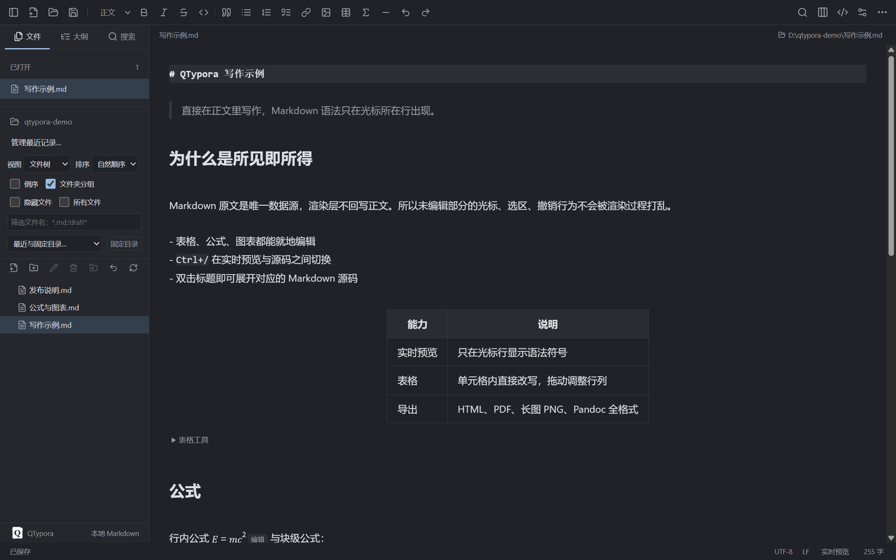
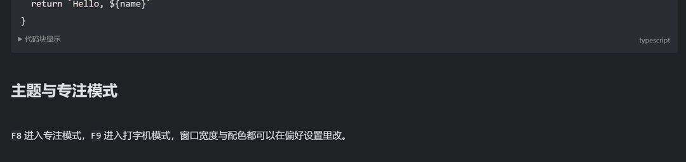
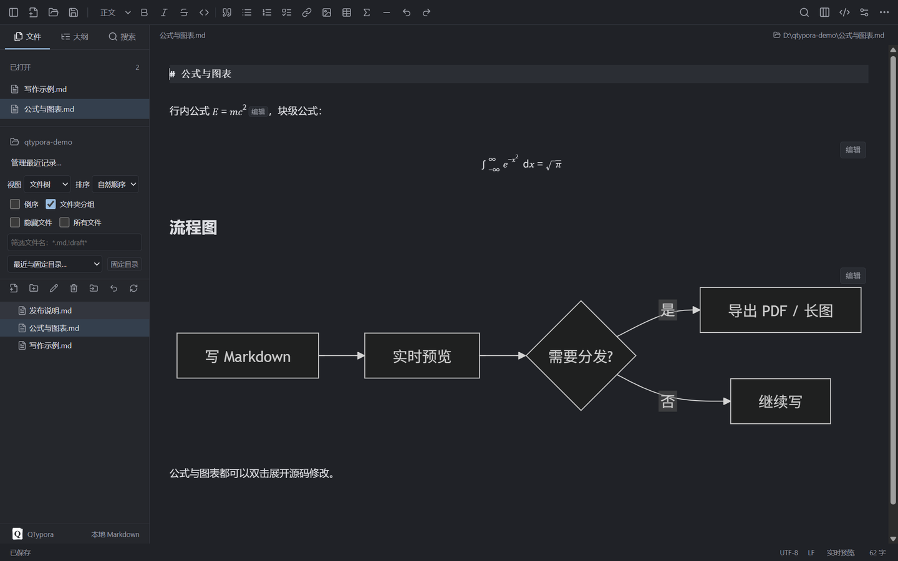

<div align="center">


<h1>QTypora</h1>

<p><strong>在地端執行的 Markdown 編輯器</strong>：即時預覽、公式與圖表、PDF 與長圖匯出。<br>
支援 Windows 與 macOS，每份文件都存成單純的 <code>.md</code> 檔。</p>

<p>
<a href="README.md">简体中文</a> ·
<a href="README.zh-TW.md"><b>繁體中文</b></a> ·
<a href="README.en.md">English</a> ·
<a href="README.ja.md">日本語</a> ·
<a href="README.ko.md">한국어</a> ·
<a href="README.es.md">Español</a>
</p>

<p>
<a href="https://github.com/sleepdecidehair/qtypora/releases"></a>
<a href="https://github.com/sleepdecidehair/qtypora/releases"></a>


</p>



</div>

QTypora 是為 Windows 與 macOS 設計的本機 Markdown 桌面編輯器，即時預覽的互動方式參考 Typora。文件存放在普通的 `.md` 檔案中，偏好設定與恢復草稿放在應用程式的使用者目錄。

目前提供 Windows 10 / 11 x64 內測安裝檔；同一份原始碼也能在 macOS 上產生 arm64、x64 兩份獨立的內測 DMG。功能仍在迭代，需求文件以簡體中文撰寫，文件中的規劃項目不代表已實作或已驗收。

功能 · [畫面](#screenshots) · [下載](#download) · [快速鍵](#shortcuts) · [開發](#development) · [專案結構](#layout) · [限制](#limits) · [授權](#license)

## 為什麼用它

| ✍️ 即時預覽 | 🔒 本機優先 | 🧰 該有的都有 |
| :--- | :--- | :--- |
| 直接在排版後的正文裡編輯，Markdown 語法只出現在游標所在的那一行；雙擊標題即可展開對應的原始碼。 | 文件就是普通的 `.md` 檔，偏好設定與草稿留在本機，不需要帳號，也不上傳內容。 | 公式、圖表、表格、大綱、工作區搜尋、PDF 與長圖匯出都已可用。 |

<a id="features"></a>
## ✨ 功能

| | 能力 |
| :--- | :--- |
| 📝 **Markdown 編輯** | 即時預覽與原始碼切換；YAML、文內目錄、Alerts、註腳、Emoji、公式與圖表；擴充語法、配對與程式碼區塊顯示可調整 |
| 🖼 **圖片與表格** | 多圖選取、圖片貼上與拖放、圖片目錄與尺寸、資源整理與可設定的上傳器；表格尺寸、行列移動與多格操作 |
| 🗂 **文件管理** | 檔案樹與文章清單、排序與篩選、最近與固定目錄、工作區內檔案及目錄的移動與重新命名、新增與複製的階段內復原、多視窗與快速開啟；搜尋支援全字、RE2 正規表達式與目錄排除 |
| 💾 **本機儲存** | 儲存、另存新檔、全部儲存、衝突檢查、恢復草稿與選用的自動儲存，啟動時可還原上次的檔案或資料夾 |
| 🎨 **寫作與外觀** | 大綱醒目提示、篩選與收合，字數統計與閱讀時間、浮動工具列、系統拼字檢查與字典；亮暗配色、字型、正文 CSS、專注與打字機模式、頁面縮放 |
| 📤 **匯入與匯出** | HTML、無樣式 HTML、PDF、長圖 PNG、Markdown、系統列印，以及跨重新啟動沿用上次匯出設定；其他格式透過你自行安裝的 Pandoc 或自訂程式轉換 |

<a id="screenshots"></a>
## 🖼 畫面

一邊輸入，一邊成形，語法符號只在游標行出現：

<div align="center">

</div>

公式與 Mermaid 流程圖就地算圖，雙擊可展開原始碼：

<div align="center">

</div>

<a id="download"></a>
## ⬇ 下載與安裝

| 平台 | 狀態 | 取得方式 |
| :--- | :--- | :--- |
| Windows 10 / 11 x64 | 內測安裝檔 | 下載 [QTypora 0.1.0 Windows x64 安裝程式](https://github.com/sleepdecidehair/qtypora/releases/download/v0.1.0-internal/QTypora-0.1.0-internal-x64-setup.exe)，在精靈中選擇安裝目錄 |
| macOS arm64 / x64 | 需自行打包 | 在 Apple Silicon Mac 上執行 `npm run package:mac:internal`，產生兩份獨立 DMG |
| 原始碼 | 可用 | 取得原始碼後依 [開發](#development) 啟動 |

SHA-256 校驗檔與內測公開憑證在 [Release 頁面](https://github.com/sleepdecidehair/qtypora/releases/tag/v0.1.0-internal)。內測版使用自簽憑證，Windows 可能顯示未知發行者或 SmartScreen 提示。簽章與驗證方式寫在打包說明中。

每次分支推送都會為該提交產生安裝檔，新版本見 [所有 Releases](https://github.com/sleepdecidehair/qtypora/releases)。

<a id="shortcuts"></a>
## ⌨ 快速鍵

| Windows / macOS | 動作 |
| :--- | :--- |
| `Ctrl/Command+N` / `Ctrl/Command+Shift+N` | 新增文件 / 新增視窗 |
| `Ctrl/Command+O` | 開啟文件 |
| `Ctrl/Command+S` / `Ctrl/Command+Shift+S` | 儲存 / 另存新檔 |
| `Ctrl/Command+W` | 關閉目前文件 |
| `Ctrl/Command+F` / `Ctrl/Command+H` | 尋找 / 取代 |
| `Ctrl/Command+/` | 切換原始碼模式 |
| `Ctrl/Command+,` | 偏好設定 |
| `Ctrl/Command+Shift+L` | 顯示或隱藏側欄 |
| `F8` / `F9` / `F11` | 專注模式 / 打字機模式 / 全螢幕 |

以上為預設值，應用程式選單的快速鍵可在偏好設定中修改、停用或還原；編輯器固定鍵與原生剪下、複製、貼上保留，衝突的設定會被拒絕。

按 `Ctrl+/` 在即時預覽與原始碼之間切換。即時預覽中雙擊可局部編輯的內容會展開對應原始碼；`Ctrl+E` 選取目前樣式內容或表格儲存格，`Ctrl+Click` 開啟連結。

<a id="development"></a>
## 🛠 開發

需要 Windows 或 macOS、Node.js **>=22.12.0** 與 npm。使用安裝檔的人不需要安裝 Node.js。

```bash
npm ci
npm run build:icon
npm run dev
```

`npm ci` 依 [package-lock.json](package-lock.json) 安裝相依套件。`dev` 啟動 Electron 視窗與本機開發伺服器；明確產生圖示可相容於停用 npm 生命週期指令碼的環境。

若安裝指令碼被停用而缺少 Electron 執行環境，可手動下載：

```bash
node node_modules/electron/install.js
```

需要透過既有系統代理下載時，先在終端設定 `$env:ELECTRON_GET_USE_PROXY = '1'`。

<a id="layout"></a>
## 🧭 專案結構

技術組成依 [package.json](package.json)：Electron 44、React 19、TypeScript 7、electron-vite 5、Vite 7、CodeMirror 6、Markdown-it、MathJax、Mermaid 與 DOMPurify。

| 路徑 | 職責 |
| :--- | :--- |
| `src/main/` | 視窗、選單、檔案服務、文件狀態、衝突檢查、設定、草稿、資源與匯出 |
| `src/preload/` | 對畫面公開的固定桌面能力介面 |
| [src/shared/contracts.ts](src/shared/contracts.ts) | 主行程與畫面共用的型別、結果與事件契約 |
| `src/renderer/` | React 介面、CodeMirror 編輯器、檔案樹、大綱、搜尋與主題 |
| `tests/` | 真實 Electron 整合測試；單元測試與原始碼相鄰 |
| `scripts/`、`build/` | 打包、簽章、檢查腳本與品牌、安裝資源 |
| `docs/` | 需求、研究、驗證紀錄與故障檢討 |

Markdown 原文是唯一的文件模型，畫面不會用算圖後的 HTML 重建文件。畫面透過預載橋接呼叫本機服務，不直接存取 Node.js，視窗維持內容隔離與沙箱。

<a id="limits"></a>
## 🚧 目前限制

支援 UTF-8 與 UTF-8 BOM。未修改就儲存會保留原始位元組；修改後沿用偵測到的 LF / CRLF 與編碼。單篇原始碼編輯上限 16 MB，即時預覽上限 200,000 字元，超過門檻時仍可編輯原始碼。全部儲存遇到取消或失敗會停止；跨目錄另存時會提示將失效的相對圖片參照。

表格、圖片貼上與拖放、富文字轉換、主題與匯出設定都已提供，但尚未完成 Typora 全量等值驗收。介面完整多語、自動更新、主題與外掛市集、自製雲端同步仍未實作。檔案與目錄操作的階段紀錄最多保留 20 筆，不包含系統資源回收筒的刪除還原。

工作區索引上限為 200 個目錄、5000 個檔案與 20000 筆項目；目錄搜尋最多回傳 1000 筆結果，長圖高度上限 16000 像素。既有的 Typora 主題目錄、主 CSS 與 `user.css` 覆蓋層只相容部分正文樣式、變數與媒體查詢，第三方 Typora 主題不算完全相容。macOS 內測 DMG 為 ad-hoc 簽章，未提交 Apple 公證。

<a id="license"></a>
## ⚖ 授權

專案授權尚未確定，因此不授權使用、重製或再散布。內附開源元件的授權不會一併授權 QTypora 本身。

第三方授權聲明隨應用程式提供，可從「說明 → 第三方授權」查看。技術文件（需求、打包、驗證與故障檢討）目前以簡體中文撰寫，連結整理在 [簡體中文 README](README.md)。

<div align="center">

如果 QTypora 對你有用，歡迎給個 Star；缺少什麼，也歡迎開 [issue](https://github.com/sleepdecidehair/qtypora/issues)。

<a href="README.md">简体中文</a> · <a href="README.zh-TW.md">繁體中文</a> · <a href="README.en.md">English</a> · <a href="README.ja.md">日本語</a> · <a href="README.ko.md">한국어</a> · <a href="README.es.md">Español</a>

</div>
